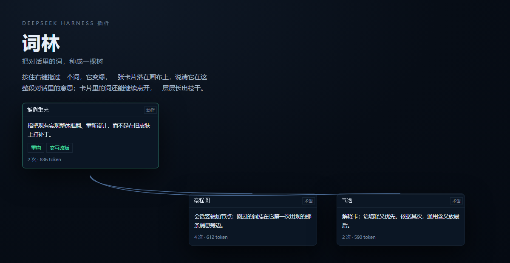
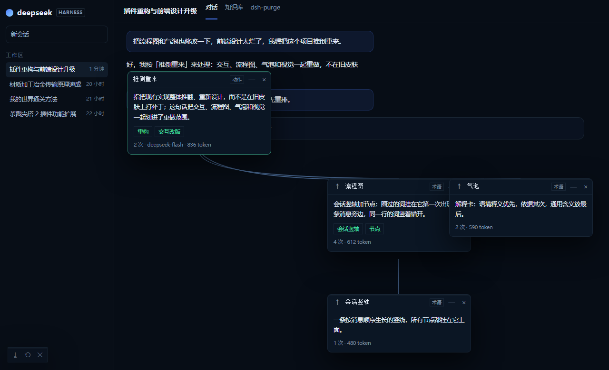
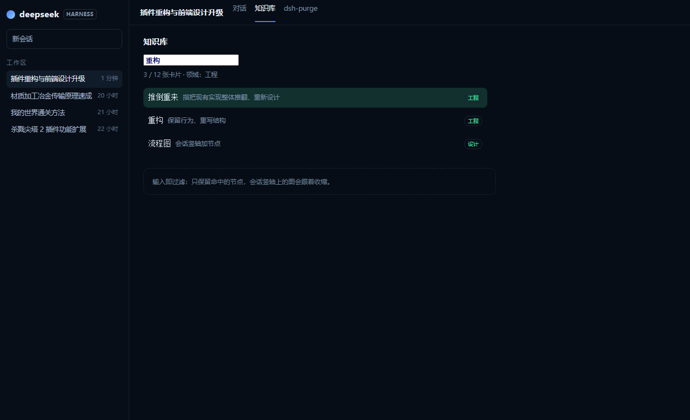
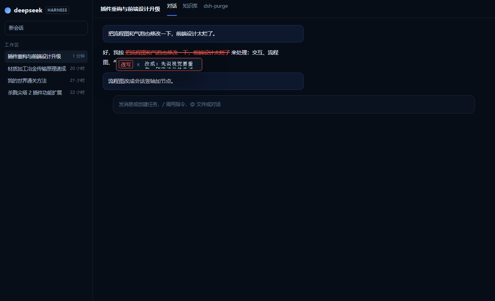
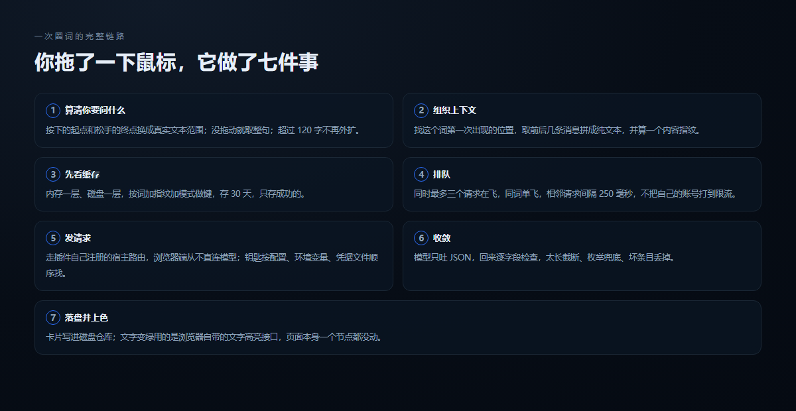
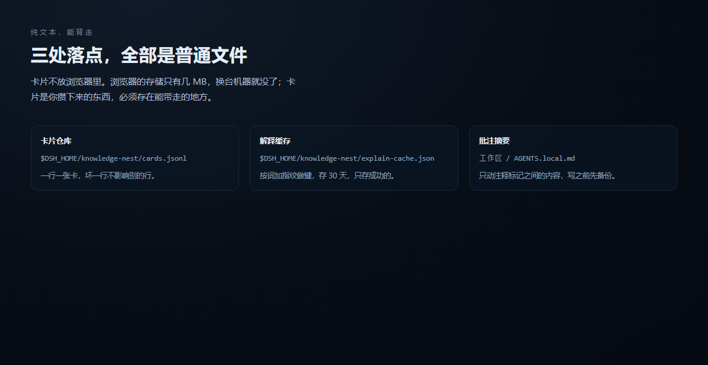

# 词林

<p align="center"></p>

<p align="center"></p>

在 DeepSeek Harness 的对话里，按住鼠标右键拖过一个词，它变绿，一张解释卡片落在画布上，告诉你**这个词在这一整段对话里到底指什么**。卡片里的词还能继续点开，一层层长成一棵树。

这个插件只做一件事：把「我好像没看懂这句话里的某个词」变成一次右键。

名字叫词林，是因为它最后会变成一片林子：你圈过的每个词都是一棵小树，卡片是枝，批注是你在树上做的记号。

---

## 先选你的版本

词林有两种装法，**功能不一样**，别下错了。

| 你在用什么 | 下这个 | 你将得到 |
|---|---|---|
| **DeepSeek Harness** | `dsh-knowledge-nest-<版本>.zip` | 完整交互：右键圈词、绿字高亮、知识树画布、批注气泡、知识库标签页 |
| **Cherry Studio**（或任何 MCP 客户端） | `knest-mcp-cherry-<版本>.zip` | 一个 MCP 工具 `knowledge_nest_explain`：把词和上下文交给它，它回一张结构化的解释卡片。**没有圈选、没有画布、没有高亮** |

为什么 Cherry 版功能少：MCP 只能传文本、回文本，客户端不给我们往对话上画东西的入口。想要那一整套交互，只能用 DSH 版。

**Cherry 版怎么填钥匙**：不用手改 JSON。接进客户端后，日志里会多出一行「配置页：http://127.0.0.1:7332/?token=...」，把这个地址丢进浏览器，选 DeepSeek 或本机 Ollama、填 key、点「保存并测试」，当场知道通不通，存完不用重启客户端。

想给 Cherry Studio 补上圈选和画布，另有办法：用调试端口把界面注入进去。那是另一套东西，见 [docs/CHERRY-STUDIO.md](docs/CHERRY-STUDIO.md)。

---

## 它会帮你做什么

**读陌生代码。** 圈住 `pointer-events:none`，得到的是「让元素不响应鼠标事件，点击会穿透到下层」，而不是词典里那句「指针事件为无」。因为它读的是你正在看的这段对话，不是通用词库。

**追一条术语链。** 卡片里凡是能继续展开的词，都做成了小按钮。点「CSS 属性」，它会在旁边长出一张新卡片，两张卡之间连一条线。再点，再长。最多三层，够你把一句话拆明白，又不至于失控。

**留下自己的批注。** 读到一处想改的句子，右键菜单选「批注这段」，那句话被标红划掉，上方浮出一个气泡写「改为：」，光标已经在那儿等你了。

**回头找得到。** 圈过的词会攒进「知识库」标签页，顶部有搜索框，按词、按释义、按领域都能筛。

---

## 怎么用

<p align="center"></p>

第一步，装。把仓库放进 DSH 的插件目录，在 `cordis.patch.yml` 末尾加上这一段：

```yaml
- insert:
    - id: dsh-knowledge-nest
      name: dsh-knowledge-nest
```

第二步，用鼠标。在对话里按住右键拖过一段字，松手会弹出菜单，菜单里挑你要的动作：

- 解释这段文本，或者解释这段代码（选区里有分号括号时它会自己换成这个说法）
- 换个说法，举个例子，翻译
- 标出同领域，把对话里同属一个领域的词一起染橙
- 批注这段，标红划掉并在上方留一个写着改法的气泡
- 收进生词本，复制，以及更多

第三步，看画布。卡片可以拖到任何地方，连线会跟着重画；按住 Alt 拖是平移，按住 Ctrl 滚轮是缩放；卡片标题栏最左边的向上箭头，点了会跳回它的上一级；右上角那颗叉会把它连同所有子卡片删掉。

第四步，回头查。顶部「知识库」标签页里有搜索框，会话竖轴上的节点会随关键词收缩。卡片存在磁盘上，关掉再开还在。

<p align="center"></p>

---

## 批注模式

<p align="center"></p>

读到一处想改的句子，右键菜单选「批注这段」。那句被标红划掉，上方浮出一个气泡，光标已经落在输入框里，直接写你要的版本。

气泡里可以切「改写」还是「划掉」。改写就是写替代文字；划掉表示这句删掉，不写替代。

你发下一条消息后，这些批注会自动淡出，但它们的内容已经写进工作区的 `AGENTS.local.md`，宿主下一轮会读进去，所以模型知道你想怎么改，不用你手动贴一遍。

---

## 用的时候，后台在做什么

<p align="center"></p>

你在屏幕上只做了一个动作：拖了一下鼠标。后台其实走了这么一串。

**一，算出你要问的是什么。** 按住右键的起点和松手的终点，会换成一段真实的文本范围。你没拖动只是点了一下，它就取指针所在的那一整句。超过一百二十个字就不再往外扩。

**二，组织上下文。** 去当前会话里找这个词第一次出现在哪，把前后几条消息拼成一段纯文本，同时算一个指纹（这段文本的内容哈希）。同一段对话里同一个词第二次问，就不再花钱。

**三，问之前先看缓存。** 内存一层，磁盘一层，磁盘那份按「词加指纹加模式」做键，存三十天，只存成功的。

**四，排队，不并发炸出去。** 同时最多三个请求在飞，相同的词只发一次，相邻两个请求至少隔两百五十毫秒。不是怕花钱，是怕把你自己的账号打到限流。

**五，发请求。** 走插件自己在宿主上注册的一条路由，浏览器端从不直连模型。钥匙按「插件配置、环境变量、`.credentials.yaml`」的顺序找。

**六，收敛。** 模型只被要求吐一个 JSON，回来逐字段检查：太长的截断，枚举不对的兜底，坏条目丢掉。

**七，落盘并上色。** 成功的卡片写进磁盘上的卡片仓库，文字变绿用的是浏览器的文字高亮接口，页面本身一个节点都没动。

从卡片的词再点开一层，会重复上面大部分步骤，但多带一段「上级概念」。因为这种词原文里往往根本没出现过，只喂对话它只会回你一句「没有上下文」。

---

## 为什么这么做

**只解释语境，不做百科。** 联网查词会把「这段对话里它指什么」变成「这个词一般指什么」，那不是你想要的。

**不改宿主的页面。** 卡片画在一层不挡鼠标的透明浮层上，对话区照常滚动、照常选中、照常复制，插件随时可以拔掉。

**卡片存在磁盘，不放在浏览器里。** 浏览器存储只有几 MB，换台机器就没了。卡片写在 `cards.jsonl`，一行一张，坏一行不影响别的行。

**批注写成工作区里的一个标记块。** 插件没法改你发出去的消息，这是宿主的边界。所以换了一条路：把批注摘要写进 `AGENTS.local.md`，用一对注释标记圈出自己的地盘，只动标记之间，写之前先备份。

---

## 东西都放在哪

<p align="center"></p>

| 内容 | 位置 |
| --- | --- |
| 卡片仓库 | `$DSH_HOME/knowledge-nest/cards.jsonl` |
| 解释缓存 | `$DSH_HOME/knowledge-nest/explain-cache.json` |
| 批注摘要 | 工作区里的 `AGENTS.local.md`，标记块之间 |
| 设置、画布位置、生词本 | 浏览器 localStorage，键名以 `dsh.knowledge-nest.` 开头 |

想清空，删对应文件即可。批注那块删掉标记之间就干净，标记之外你自己写的内容不会被碰。

---

## 边界

- 只在 DeepSeek Harness 里完整可用，别的客户端不给这个口子。
- 一次圈词约八百 token，追问一层约五百；同词同对话只问一次。
- 最多三层，到第三层的词会变灰。
- 快捷键已全部移除，所有动作都从右键菜单进。
- 画布位置会记住，但换会话不隔离，它是一张全局的图。

---

## 欢迎魔改

这份代码是给你改的，不是给你供着的。

想改外观，动 `client/styles.js`，里面是一整个 CSS 字符串数组。颜色优先读宿主的设计令牌（`--dsw-alias-*`），读不到才用自带的兜底色板，所以宿主换主题你这边自动跟着变。

想改交互，动 `client/selector.js`（怎么读选区）、`client/tree-board.js`（画布、连线、拖拽、多选）、`client/annotate.js`（批注的红字、气泡、跟随）。

想改问法，动 `lib/prompt.js`（提示词和输出格式）、`lib/shape.js`（回来之后怎么收敛）。想换模型或供应商，`lib/key.js` 和 `packages/mcp-server/src/model.js` 是两处钥匙解析，前者给插件用，后者给独立的 MCP 工具用，互不干扰。

想加新动作，`client/menu.js` 里加一项，`client/view.js` 的 `onMenuAction` 里加一个分支，两步。

改完跑一遍：

```bash
node tools/build-client.mjs
node --test
```

图解本身也是代码：`tools/preview-readme.mjs` 生成 `docs/assets/*.html`，之后截图成 PNG。想改图里的文案或配色，改那个文件重新跑就行。

插件和宿主的接触面只有三处：注册一个视图插槽（对话区那个「知识库」标签页）、注册一个设置插槽、注册几条 HTTP 路由。想接别的地方，照抄这三处就行。

---

## 说明

这是给个人用的工具，作者自己每天都在用，所以更新跟着自己的手感走，不保证兼容性承诺。

发现问题欢迎直接改，改完发回来更好。你能想到的用法多半比作者想得多。
